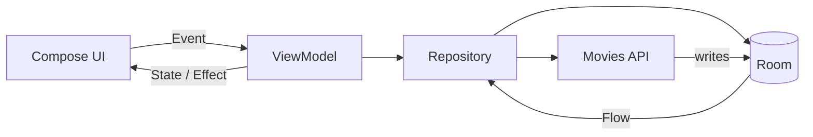

# Imoves

**Imoves** is a modern Android movie discovery application built with Jetpack Compose. It provides an
offline-first browsing experience: movies are cached locally with Room, loaded incrementally with
Paging 3, and searched instantly from the local cache.


---

## Table of Contents

- [Overview](#overview)
- [Features](#features)
- [Tech Stack](#tech-stack)
- [Architecture](#architecture)
- [Project Structure](#project-structure)
- [Getting Started](#getting-started)
- [Build Variants](#build-variants)
- [Testing](#testing)
- [Design Decisions](#design-decisions)
- [Localization](#localization)
- [Roadmap](#roadmap)
- [Contributing](#contributing)
- [License](#license)
- [Author](#author)

---

## Overview

Imoves follows Clean Architecture principles with three production modules (`:app`, `:domain`,
`:data`) and a shared `build-logic` included build. The UI is built entirely with Jetpack Compose and
follows an MVVM + unidirectional data flow pattern, with Hilt providing dependency injection across
all layers.

The application uses a single source of truth design: Room stores the cached movie feed and Paging 3
observes it, while a `RemoteMediator` keeps the cache in sync with the backend.

## Features

- **Discover feed** — browse movies in a responsive two-column grid.
- **Infinite pagination** — Paging 3 with a `RemoteMediator` loads the next pages as the user scrolls.
- **Offline-first caching** — Room persists the feed so content remains available without a network.
- **Local search** — debounced search filters the cached movies directly in Room, with no extra network
  requests.
- **Movie details** — backdrop, poster, rating, vote count, release date, original language and overview.
- **Typed navigation** — `@Serializable` destinations with a single `Navigator` abstraction over
  `NavHostController`.
- **Consistent state handling** — shared base screen/state layer with loading, empty, error and retry
  states.
- **Typed error mapping** — transport-agnostic `AppError` values produced from network, HTTP and
  parsing failures.
- **Arabic UI with RTL support** — all user-facing strings are localized and the layout handles RTL
  directionality.

## Tech Stack

| Area | Technology |
| --- | --- |
| Language | Kotlin 2.2.10 |
| UI | Jetpack Compose, Material 3, Coil 3 |
| Architecture | MVVM, unidirectional data flow, repository pattern |
| Dependency Injection | Hilt 2.60.1 |
| Async | Kotlin Coroutines, Flow |
| Pagination | Paging 3 (`RemoteMediator`) |
| Persistence | Room 2.8.5 |
| Networking | Retrofit 3.0.0, OkHttp 5.4.0, Gson, Chucker |
| Navigation | Navigation Compose 2.9.0, kotlinx.serialization |
| Build | Gradle 9.3.1, Kotlin DSL, version catalog, custom `build-logic` |
| Testing | JUnit 4, Compose UI Test |

## Architecture

### Modules

| Module | Responsibility |
| --- | --- |
| `:app` | Compose UI, ViewModels, navigation, Hilt bootstrap and application-level DI. |
| `:domain` | Pure models, repository contracts, use cases and transport-agnostic errors. |
| `:data` | Retrofit API, Room database, data sources, mappers, Paging mediator and DI modules. |
| `build-logic` | Included Gradle build that exposes configuration helpers and the `staging` build type. |

### Data Flow



- The ViewModel exposes a `Flow<PagingData<Movie>>` collected by the Compose UI.
- `GetMoviesUseCase` wraps the repository call and keeps the ViewModel independent of data sources.
- `MoviesRepositoryImpl` creates a Pager backed by Room.
- `MovieRemoteMediator` calls the API and writes the response into Room, which then emits new pages.

### Navigation

Destinations are type-safe and serializable:

```kotlin
@Serializable
data object DiscoverRoute

@Serializable
data class MovieDetailsRoute(val movieId: Int)
```

`AppNavigator` implements the `Navigator` interface and is provided through `LocalNavigator`, so
feature code never talks to `NavHostController` directly.

## Project Structure

```text
Imoves/
├── app/
│   └── src/
│       ├── main/java/com/triangles/imoves/
│       │   ├── base/state/          # BaseViewModel, BaseScreen, state and paging helpers
│       │   ├── di/                  # Application-level Hilt modules
│       │   ├── features/
│       │   │   ├── common/          # Shared composables (poster, rating badge, system bars)
│       │   │   ├── movies/home/     # Discover screen, ViewModel and contracts
│       │   │   ├── movies/details/  # Movie details screen, ViewModel and components
│       │   │   └── navigation/      # Typed destinations, Navigator and AppNavigator
│       │   └── ui/theme/            # Colors, typography and shapes
│       ├── test/                    # JVM unit tests
│       └── androidTest/             # Compose UI tests
├── data/
│   └── src/main/java/com/triangles/data/
│       ├── database/                # Room database and database module
│       ├── features/moves/
│       │   ├── di/                  # Bindings for repository and data sources
│       │   ├── mapper/              # Response/entity/domain mappers
│       │   ├── mediator/            # Paging 3 RemoteMediator
│       │   ├── model/               # Network response models
│       │   ├── repository/          # MoviesRepository implementation
│       │   └── source/local|remote/ # Room and Retrofit data sources
│       └── network/                 # OkHttp/Retrofit setup and error mapping
├── domain/
│   └── src/main/java/com/triangles/domain/
│       ├── core/error/              # AppError and DomainErrorException
│       └── features/moves/
│           ├── di/                  # Hilt providers for use cases
│           ├── model/               # Movie and MovieDetails
│           ├── repository/          # Repository contracts
│           └── usecase/             # GetMoviesUseCase
├── build-logic/                     # Included Gradle build and helper plugin
├── gradle/libs.versions.toml        # Centralized dependency versions
└── Imoves-config.properties         # Local build configuration (do not commit)
```

## Getting Started

### Requirements

- Android Studio (latest stable)
- JDK 21
- Android SDK 36
- Android device or emulator running API 24+

### Configuration

The build reads environment-specific values from a root-level `Imoves-config.properties` file. Create
it locally:

```properties
DEV-API-URL=https://your-dev-api.example.com
STAGING-API-URL=https://your-staging-api.example.com
PRODUCTION-API-URL=https://your-production-api.example.com

VER-NUMBER=1
VERSION-NAME=1.0
```

The Gradle build injects the matching `API_URL` value into `BuildConfig` for each variant.

> **Security:** keep this file out of version control. Do not commit API credentials, keystore
> passwords or signing keys.

### Build and Run

```bash
# Clone
git clone https://github.com/Dev-AndrewMagdy/Imoves.git
cd Imoves

# Build the debug APK
./gradlew :app:assembleDebug

# Install on a connected device/emulator
./gradlew :app:installDebug
```

On Windows, use `gradlew.bat` instead of `./gradlew`.

## Build Variants

| Variant | API URL source | Purpose |
| --- | --- | --- |
| `debug` | `DEV-API-URL` | Local development and debugging |
| `staging` | `STAGING-API-URL` | Pre-release verification |
| `release` | `PRODUCTION-API-URL` | Production distribution |

## Testing

| Scope | Command | Location |
| --- | --- | --- |
| Domain unit tests | `./gradlew :domain:testDebugUnitTest` | `domain/src/test` |
| Data unit tests | `./gradlew :data:testDebugUnitTest` | `data/src/test` |
| Compose UI tests | `./gradlew :app:connectedDebugAndroidTest` | `app/src/androidTest` |
| App compilation | `./gradlew :app:compileDebugKotlin` | — |

The test suite currently covers:

- `GetMoviesUseCase` delegation and query forwarding.
- `MovieRemoteMediator` refresh/append behavior, including stale `PagingState` handling, end of
  pagination and error propagation.
- `MovieCard` rendering and click behavior.
- `MoviesSearchBar` input and clear actions.

## Design Decisions

**Offline-first by default.** Room is the single source of truth. The UI observes the database, and
the network layer only writes into it through the Paging mediator. This keeps rendering consistent and
makes cached content available immediately.

**Persisted pagination state.** A dedicated `RemotePageState` row stores the next remote page and
whether the feed is complete. This avoids deriving pagination from a potentially stale `PagingState`
captured before the local refresh has populated Room.

**Type-safe navigation.** Navigation destinations are serializable data classes/objects instead of
string routes, and all navigation operations go through the `Navigator` abstraction.

**Centralized error mapping.** Network, HTTP and parsing failures are converted once into `AppError`
values so the domain and UI layers never depend on Retrofit or Gson types.

**Modularization.** UI, domain rules and data access are separated by module, keeping the domain layer
free of Android framework and third-party data dependencies.

## Localization

The app ships with Arabic strings and RTL layout support. All copy lives in
`app/src/main/res/values/strings.xml`. To add a language, create the appropriate
`values-<locale>/strings.xml` resource directory.


## Author

**Andrew Magdy**

- GitHub: [@Dev-AndrewMagdy](https://github.com/Dev-AndrewMagdy)
- Repository: [Dev-AndrewMagdy/Imoves](https://github.com/Dev-AndrewMagdy/Imoves)
